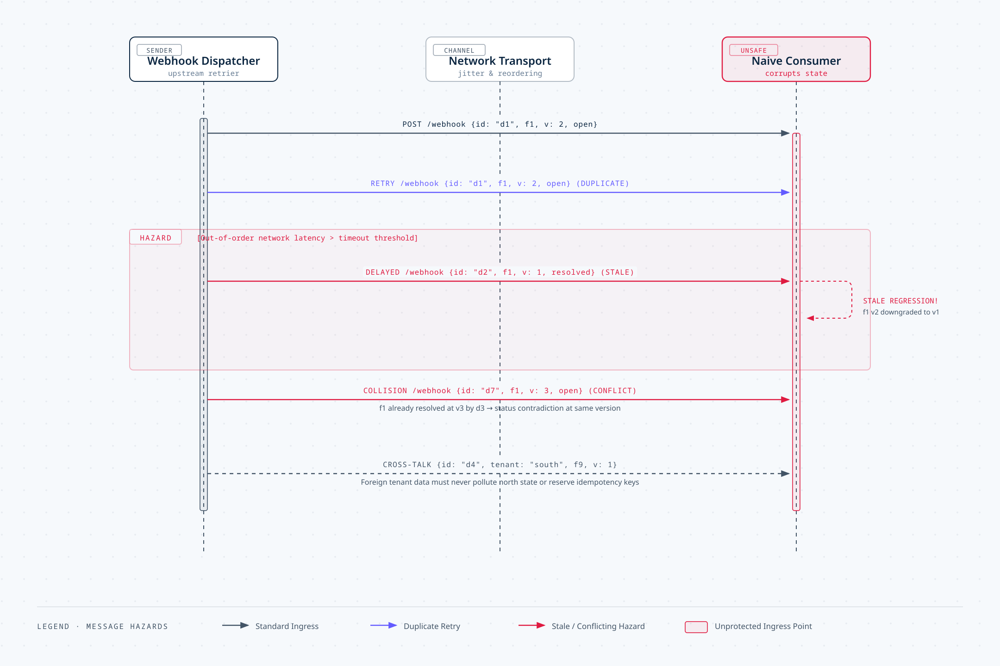
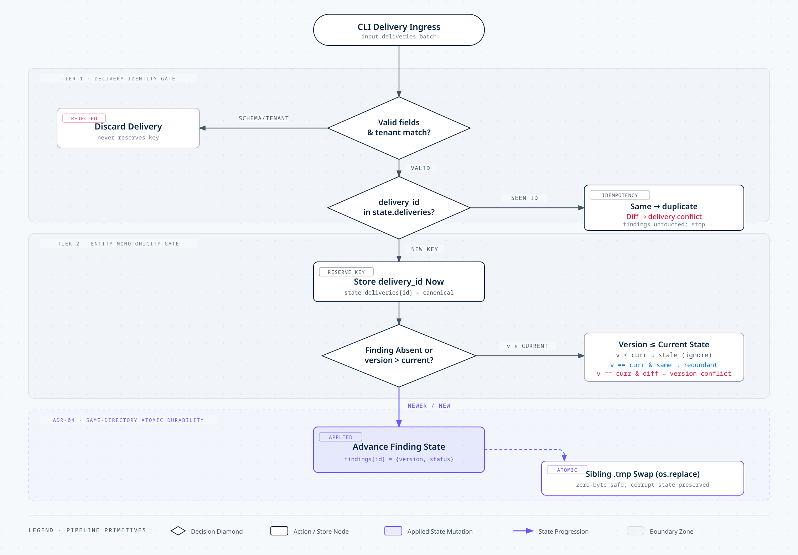

# Idempotent Local Webhook Inbox: Submission Deliverables

This document fulfills the four required submission deliverables specified in [README.md](file:///home/regisx001/04-webhook-inbox/README.md#L60-L72):
1. [Short Run Guide](#1-short-run-guide)
2. [Decision and Work Log](#2-decision-and-work-log)
3. [AI-Use Note](#3-ai-use-note)
4. [Accessible Walkthrough Narrative](#4-accessible-walkthrough-narrative)
5. [Visual Diagrams (Stripe Editorial Spec)](#5-visual-diagrams)
6. [Academic Technical Paper (LaTeX)](#6-academic-technical-paper-latex)

> **Key Artifacts Available:**
> - **Technical Paper (LaTeX Source):** [`paper/main.tex`](file:///home/regisx001/04-webhook-inbox/paper/main.tex) (Complete professional research paper with mathematical models, code listings, ADRs, and verification metrics).
> - **Problem Analysis Diagram:** [`docs/diagram-problem.html`](file:///home/regisx001/04-webhook-inbox/docs/diagram-problem.html) (Sequence diagram of redelivery races, stale regressions, and conflict hazards).
> - **Solution Architecture Diagram:** [`docs/diagram-solution.html`](file:///home/regisx001/04-webhook-inbox/docs/diagram-solution.html) (Two-tier decision pipeline and ADR-04 atomic state durability).

---

## 1. Short Run Guide

### 1.1 Environment & Prerequisites
- Python **3.10 or later** (uses standard library exclusively; zero third-party dependencies).
- Execution commands are run from the repository root:
  ```bash
  python3 --version
  python3 app.py --help
  ```

### 1.2 Exact Fixture Execution Commands

Run the sequential verification workflow using a clean scratch state file:

#### Command 1: Fresh Primary Run
```bash
rm -f scratch-state.json
python3 app.py --input inputs/primary.json --tenant north --state scratch-state.json
```
**Output (stdout):**
```json
{
  "counts": {
    "applied": 3,
    "duplicate": 1,
    "redundant": 0,
    "rejected": 4,
    "stale": 1
  },
  "findings": {
    "f1": {
      "status": "resolved",
      "version": 3
    },
    "f2": {
      "status": "open",
      "version": 1
    }
  },
  "results": [
    {"delivery_id": "d1", "outcome": "applied", "reason": "finding updated", "row": 1},
    {"delivery_id": "d1", "outcome": "duplicate", "reason": "duplicate delivery", "row": 2},
    {"delivery_id": "d1", "outcome": "rejected", "reason": "delivery conflict", "row": 3},
    {"delivery_id": "d2", "outcome": "stale", "reason": "stale version", "row": 4},
    {"delivery_id": "d3", "outcome": "applied", "reason": "finding updated", "row": 5},
    {"delivery_id": "d4", "outcome": "rejected", "reason": "foreign tenant: south", "row": 6},
    {"delivery_id": "d5", "outcome": "rejected", "reason": "version must be a positive integer", "row": 7},
    {"delivery_id": "d6", "outcome": "applied", "reason": "finding updated", "row": 8},
    {"delivery_id": "d7", "outcome": "rejected", "reason": "version conflict", "row": 9}
  ]
}
```
*Exit Code:* `0`

#### Command 2: Primary Replay Against Saved State
```bash
python3 app.py --input inputs/primary.json --tenant north --state scratch-state.json
```
**Output (stdout):**
```json
{
  "counts": {
    "applied": 0,
    "duplicate": 6,
    "redundant": 0,
    "rejected": 3,
    "stale": 0
  },
  "findings": {
    "f1": {
      "status": "resolved",
      "version": 3
    },
    "f2": {
      "status": "open",
      "version": 1
    }
  },
  "results": [
    {"delivery_id": "d1", "outcome": "duplicate", "reason": "duplicate delivery", "row": 1},
    {"delivery_id": "d1", "outcome": "duplicate", "reason": "duplicate delivery", "row": 2},
    {"delivery_id": "d1", "outcome": "rejected", "reason": "delivery conflict", "row": 3},
    {"delivery_id": "d2", "outcome": "duplicate", "reason": "duplicate delivery", "row": 4},
    {"delivery_id": "d3", "outcome": "duplicate", "reason": "duplicate delivery", "row": 5},
    {"delivery_id": "d4", "outcome": "rejected", "reason": "foreign tenant: south", "row": 6},
    {"delivery_id": "d5", "outcome": "rejected", "reason": "version must be a positive integer", "row": 7},
    {"delivery_id": "d6", "outcome": "duplicate", "reason": "duplicate delivery", "row": 8},
    {"delivery_id": "d7", "outcome": "duplicate", "reason": "duplicate delivery", "row": 9}
  ]
}
```
*Exit Code:* `0`  
*(Notice: Rows 1, 2, 4, 5, 8, and 9 deduplicate because their keys were stored in run 1).*

#### Command 3: Secondary Fixture Run on Persisted State
```bash
python3 app.py --input inputs/secondary.json --tenant north --state scratch-state.json
```
**Output (stdout):**
```json
{
  "counts": {
    "applied": 2,
    "duplicate": 0,
    "redundant": 1,
    "rejected": 0,
    "stale": 0
  },
  "findings": {
    "f1": {
      "status": "open",
      "version": 4
    },
    "f2": {
      "status": "resolved",
      "version": 2
    }
  },
  "results": [
    {"delivery_id": "s1", "outcome": "applied", "reason": "finding updated", "row": 1},
    {"delivery_id": "s2", "outcome": "redundant", "reason": "redundant status", "row": 2},
    {"delivery_id": "s3", "outcome": "applied", "reason": "finding updated", "row": 3}
  ]
}
```
*Exit Code:* `0`

### 1.3 Error Handling & Boundary Commands
```bash
# Missing input file (reports error on stderr, exits 2)
python3 app.py --input inputs/does-not-exist.json

# Malformed input JSON (reports error on stderr, exits 2)
python3 app.py --input inputs/malformed-input.txt

# State path matching input path (reports error on stderr, exits 2)
python3 app.py --input inputs/primary.json --state inputs/primary.json
```

### 1.4 Automated Verification Suite
Run the 18-test automated suite (including starter checks, schema validation, byte immutability, and custom boundary cases):
```bash
python3 -m unittest discover -s tests -p '*_test.py' -v
```

---

## 2. Decision and Work Log

### 2.1 Priorities and What Was Deferred
- **Priorities:**
  1. Strict adherence to the contract invariants: two-tier evaluation (Delivery Identity Gate $\rightarrow$ Entity Monotonicity Gate).
  2. Bulletproof byte-level durability and state integrity: atomic file swapping and zero-mutation policies for corrupt state files.
  3. Defensive data validation: type coercion protection for integer versions and strict string trimming.
- **What Was Deferred:**
  1. *Distributed Locking / Process Concurrency:* The specification explicitly states: *"no concurrency or crash-injection framework is required."* Multi-process mutexes/file locks (`fcntl.flock`) were deferred to avoid platform-specific lock-contention issues.
  2. *Database Storage (SQLite / PostgreSQL):* Local JSON files are the required contract format; an embedded relational database would introduce unnecessary abstraction layers.
  3. *HTTP Webhook Receiver / Network Layer:* Strictly outside the local CLI evaluation scope.

### 2.2 Obstacle 1 & Response: Durability & Filesystem Atomicity
- **Obstacle:**
  Directly writing state with `open(state_path, "w")` or truncating in place risks leaving a zero-byte or corrupted file if the CLI process is killed midway or hits an I/O error. Additionally, creating temporary files in system `/tmp` causes `os.replace` to perform non-atomic cross-filesystem copies if `/tmp` is mounted on a different partition than the workspace.
- **Response:**
  Implemented atomic local replacement using a hidden sibling temporary file in the exact same directory:
  ```python
  target = state_path.resolve()
  temp_path = target.with_name(f".{target.name}.tmp")
  temp_path.write_text(json.dumps(state, indent=2, sort_keys=True) + "\n", encoding="utf-8")
  temp_path.replace(target)
  ```
  On POSIX systems, `replace` in the same directory is guaranteed to be an atomic filesystem inode swap. If writing fails, `temp_path` is cleaned up, original state bytes remain untouched, and the CLI exits with code 2.

### 2.3 Obstacle 2 & Response: The Row 9 Key Reservation Trap
- **Obstacle:**
  In `inputs/primary.json`, Row 9 (`delivery_id: d7`, `finding_id: f1`, `version: 3`, `status: open`) arrives when `f1` is already at version 3 `resolved` (set by Row 5 `d3`). Row 9 has matching version (3) but conflicting status (`open` vs `resolved`), making its outcome `rejected` (`version conflict`).
  If all rejected rows discard their delivery keys, redelivering `primary.json` in Run 2 treats Row 9 as a new row again, generating `duplicate: 5, rejected: 4` instead of the expected `duplicate: 6, rejected: 3`.
- **Response:**
  Decoupled payload validity from entity state conflicts:
  - Malformed and foreign-tenant rows (Rows 6 & 7) fail structural validation and **never** reserve a key.
  - Valid deliveries with entity version conflicts (Row 9) **do** reserve their key in `state["deliveries"]` before monotonicity checks. On replay, the inbox recognizes `d7` with identical canonical payload and correctly classifies it as `duplicate`.

### 2.4 Validation Refinement: Python Boolean Type Coercion Guard
- **Observation:**
  In Python, `bool` is a subclass of `int` (`isinstance(True, int) is True`). A naive check `isinstance(version, int) and version > 0` evaluates `"version": true` as integer `1`, silently corrupting finding versioning.
- **Refinement:**
  Implemented strict type identity checking:
  ```python
  type(version) is int and not isinstance(version, bool) and version > 0
  ```
  Backed by automated unit test `testValidateRow_whenVersionBoolean_rejects`.

### 2.5 Known Limits & Next Step
- **Known Limit:** In-memory dictionary processing assumes event batches fit into RAM.
- **Next Step:** For unbounded production streams, stream JSON payloads with `ijson` and back state persistence with SQLite in WAL mode.

---

## 3. AI-Use Note

### 3.1 Guiding Philosophy & Methodology
AI assistance was utilized strictly as an interactive architectural advisor, edge-case sparring partner, and test-review tool. Rather than asking AI to generate code blind, the development process was intentionally structured so that AI **guided me in the right direction**:
1. **Upfront Problem Clarification (Zero-Code Briefing):** Began by prompting the AI to analyze the assessment constraints, edge cases, and decision gates without writing code, allowing me to build a complete mental model before implementing anything.
2. **Architectural Decision Framing (ADR Formulation):** Evaluated critical design trade-offs with AI assistance, producing clear architectural decision records (**ADR-03**, **ADR-04**, **ADR-05**, **ADR-06**).
3. **Defensive Review & Hallucination Correction:** Rigorously cross-checked all AI suggestions against the README rules, catching and correcting flawed AI proposals (such as pre-filtering deliveries or lazy key reservation).

---

### 3.2 The Initial Problem Briefing: Prompt & AI Answer
The development workflow began with the explicit briefing prompt preserved in [`ai_use/01-Explanation.md`](file:///home/regisx001/04-webhook-inbox/ai_use/01-Explanation.md):

#### The Prompt:
> *"Explain the problem to me clearly before I start solving it. Break down the requirements, explain what is expected from me, provide practical examples and edge cases, and suggest how I should approach the problem step by step.*
>
> *Do not give me the solution, write code, or implement anything. I want to understand the problem, the reasoning behind it, and how to solve it independently."*

#### The AI's Guiding Response:
The AI returned a structured, code-free problem breakdown that shaped the entire implementation plan:
1. **The Problem in One Paragraph:** A partner system redelivers finding status events (`open` / `resolved`) after timeouts, sometimes out of order. Build a CLI that processes deliveries in-order, decides what each means, updates local JSON state, and prints a JSON report. A second process run must never double-apply or regress state.
2. **Core Concepts Clarified:**
   - *Idempotency key:* `delivery_id`. Seen before = do not act twice.
   - *Canonical payload:* `{tenant, finding_id, version, status}` after trimming. Distinguishes identical redelivery from conflicting ID reuse.
   - *Monotonic version:* A finding's version only ascends; older events never overwrite newer ones.
   - *Durable state & Atomic writes:* Local state survives separate process invocations and is never left half-written.
3. **Per-Row Decision Precedence:** Defined the 7-step sequence (Validation $\rightarrow$ Duplicate $\rightarrow$ Delivery Conflict $\rightarrow$ Applied $\rightarrow$ Stale $\rightarrow$ Redundant $\rightarrow$ Version Conflict) and highlighted that steps 4–7 **must store the new delivery ID even when the outcome is stale or version-conflicted**.
4. **Fixture Hand-Trace & Answer Key:** Encouraged hand-tracing `inputs/primary.json` before writing code, explicitly calling out the behavior of `d7` (Row 9) on Run 2 and `d4`/`d5` (invalid rows never reserving keys).
5. **Edge Cases Flagged Early:**
   - `version: true`: In Python, `isinstance(True, int)` is `True`. Flagged the need to exclude boolean coercion.
   - String trimming: Trimming `" open "` vs `"open"` before comparing canonical payloads.
   - Mid-batch state evolution: Earlier rows in a batch must immediately affect later rows in the same batch.
   - Zero byte mutations: Ensuring corrupt state files abort with exit 2 and zero writes.

---

### 3.3 Core Architectural Guidance: The ADR Matrix
The AI guided the formalization of four pivotal Architectural Decision Records (ADRs) that guaranteed correctness across both runs:

| ADR ID | Decision Area | Chosen Architecture (Guided by AI) | Key Alternative Considered | Primary Tradeoff & Rationale |
|---|---|---|---|---|
| **ADR-03** | **Key Reservation Timing** | **Immediate reservation** of new valid `delivery_id` keys before version evaluation | Lazy reservation only on `applied` outcomes | *Tradeoff:* Version-conflicted rows (Row 9 `d7`) correctly deduplicate on Run 2 replay (`duplicate: 6`), whereas lazy reservation caused replay re-rejections (`duplicate: 5`). |
| **ADR-04** | **Durability & Atomicity** | **Same-directory temporary file write** with POSIX atomic `os.replace` | Direct file write with in-place truncation | *Tradeoff:* Eliminates 0-byte file truncation risks on unexpected crashes with microscopic temporary file overhead. |
| **ADR-05** | **Error & State Integrity** | **Strict fail-fast** on malformed/foreign state with zero byte mutations | Automatic state repair or fallback to empty state | *Tradeoff:* Prioritizes forensic data safety and error visibility over risky auto-recovery. Verified by testing byte invariants on corrupt files. |
| **ADR-06** | **Type System Validation** | **Strict type identity** (`type(v) is int and not isinstance(v, bool)`) | Python standard `isinstance(v, int)` | *Tradeoff:* Prevents boolean coercion (`version: true` evaluated as integer `1`) from corrupting monotonic finding state. |

---

### 3.4 Concrete Accepted, Corrected, and Rejected Outputs

#### 1. Concrete Accepted Suggestion: ADR-04 (Same-Directory Atomic Replacement)
- **What was suggested:** The AI recommended using sibling temporary file swapping (`target.with_name(f".{target.name}.tmp")`) combined with `temp_path.replace(target)`.
- **Why it was accepted:** A direct `open(state_path, "w")` immediately truncates the file to 0 bytes before writing, exposing state to total loss if interrupted. Furthermore, using system `/tmp` often crosses filesystem boundaries (e.g. `tmpfs` RAM disk), causing `replace` to fall back to a non-atomic copy. The same-directory pattern guarantees atomic inode swapping on POSIX systems.

#### 2. Concrete Corrected Hallucination: Key Reservation Timing (Row 9 Trap)
- **AI Proposal:** When asked how to handle rejected rows, the AI initially proposed skipping state updates entirely for all non-applied rows.
- **Why it was wrong:** In `primary.json`, Row 9 (`d7, f1, v3 open`) conflicts with existing finding `f1` (`v3 resolved`) and is classified as `rejected (version conflict)`. If `d7` is not reserved in `state["deliveries"]`, the replay run (Run 2) re-evaluates `d7` as a new row, producing `duplicate: 5, rejected: 4` instead of the expected `duplicate: 6, rejected: 3`.
- **Correction:** I corrected the AI's proposal by establishing ADR-03: decouple delivery syntax validation from entity state conflicts. Schema-invalid rows never reserve keys, but valid deliveries with entity conflicts **must** reserve their key immediately.

#### 3. Concrete Rejected Suggestion: Pre-Filtering Input Deliveries
- **AI Proposal:** The AI initially suggested pre-filtering deliveries using `seen = set()` and `json.dumps(row)` to deduplicate incoming rows before running the business loop.
- **Why it was rejected:** Pre-filtering dropped rows from the results array (violating the requirement for 1-based indexed results for every row) and made it impossible to detect Delivery Conflicts (same ID with different payloads). I rejected this in favor of a single sequential in-order pipeline.

#### 4. Concrete Corrected Type Check: Python Boolean Subclass Trap
- **AI Proposal:** `isinstance(version, int) and version > 0`.
- **Why it was wrong:** In Python, `bool` is a subclass of `int` (`issubclass(bool, int) is True`), allowing `version: true` to be treated as `1`.
- **Correction:** Corrected to strict type checking: `type(version) is int and not isinstance(version, bool) and version > 0` (ADR-06).

---

### 3.5 Verification Methodology
Every piece of guidance and code was validated against:
- **Exact Fixture Execution:** 3 sequential verification runs matching documented counts (`3/1/1/0/4` $\rightarrow$ `0/6/0/0/3` $\rightarrow$ `2/0/0/1/0`).
- **Byte Invariance:** Automated test verifying that corrupt state files remain 100% byte-identical on disk after a fatal exit 2.
- **Automated Regression Suite:** 18 passing unit tests in [`tests/app_test.py`](file:///home/regisx001/04-webhook-inbox/tests/app_test.py).

---

## 4. Accessible Walkthrough Narrative

### 4.1 Architecture & Core Workflow
The webhook inbox processes redelivered finding events through a two-tier decision pipeline:

1. **Top-Level Request Gate:**
   - Validates that the input payload is a JSON object with a matching tenant string and a `deliveries` array.
   - Verifies `--state` does not collide with `--input`.
   - Loads existing state JSON. If the file is absent, initializes an empty state structure. If the file exists but has syntax errors, invalid schema, or a foreign tenant, the process aborts immediately with exit code `2` without modifying disk bytes.

2. **Sequential Event Processing Loop:**
   Every delivery row is evaluated in 1-based order:
   - **Syntax & Isolation Validation:** Verifies non-empty string fields (`delivery_id`, `tenant`, `finding_id`, `status`), positive integer `version`, valid status (`open` or `resolved`), and matching tenant. Any violation rejects the row without reserving its idempotency key.
   - **Tier 1: Delivery Identity Gate (Idempotency):**
     If `delivery_id` is already stored:
     - If the canonical payload `{tenant, finding_id, version, status}` matches stored state $\rightarrow$ outcome `duplicate`, reason `"duplicate delivery"`.
     - If the payload differs $\rightarrow$ outcome `rejected`, reason `"delivery conflict"`.
     - Row processing stops here; entity findings are never modified.
   - **Key Reservation:**
     New valid delivery IDs are immediately stored in `state["deliveries"]`.
   - **Tier 2: Entity Monotonicity Gate (Findings Freshness):**
     Evaluates incoming version against `state["findings"][finding_id]`:
     - `version > current` (or finding absent): Update finding version and status $\rightarrow$ outcome `applied`.
     - `version < current`: Old redelivery $\rightarrow$ outcome `stale`. Finding is untouched.
     - `version == current` and `status == current`: Duplicate state $\rightarrow$ outcome `redundant`. Finding is untouched.
     - `version == current` and `status != current`: Conflicting state $\rightarrow$ outcome `rejected` (`"version conflict"`). Finding is untouched.

3. **Atomic Persistence:**
   Once all rows are processed, updated state is serialized to a sibling temporary file in the state directory and swapped atomically using `replace`. Successful runs output the canonical JSON payload to stdout and exit `0`.

### 4.2 Edge Case Deep Dive: Row 9 Key Reservation vs. Row 6/7 Discard
Consider the difference between Row 6, Row 7, and Row 9 in `primary.json`:
- **Row 6 (`d4`, tenant `south`):** Rejected due to foreign tenant isolation. If tenant `north` later receives an authentic delivery with ID `d4`, it must not be blocked. Therefore, `d4` is never recorded in state.
- **Row 7 (`d5`, version `0`):** Rejected due to invalid schema (version must be $>0$). A corrected redelivery of `d5` with a valid version must be allowed. Thus, `d5` is never recorded in state.
- **Row 9 (`d7`, version `3`, status `open`):** The delivery payload itself is syntactically valid and belongs to tenant `north`. However, finding `f1` is already at version `3` `resolved`. Because two conflicting statuses cannot exist at the same version, the event is rejected as a `"version conflict"`. Crucially, the delivery was successfully received and evaluated. Reserving its key ensures that when the upstream webhook sender redelivers `d7`, the inbox recognizes it as a known duplicate rather than continuously failing with version conflicts.

### 4.3 Evidence of Execution
Below is raw terminal evidence of execution across the full test lifecycle:

```text
$ python3 -m unittest discover -s tests -p '*_test.py' -v
testCli_whenEmptyDeliveries_succeedsWithZeroCountsAndCreatesState (app_test.BoundaryAndEdgeCaseTests.testCli_whenEmptyDeliveries_succeedsWithZeroCountsAndCreatesState) ... ok
testCli_whenStateTenantMismatch_exitsTwoAndPreservesState (app_test.BoundaryAndEdgeCaseTests.testCli_whenStateTenantMismatch_exitsTwoAndPreservesState) ... ok
testCli_whenVersionConflictRejected_keyIsReservedForReplayDeduplication (app_test.BoundaryAndEdgeCaseTests.testCli_whenVersionConflictRejected_keyIsReservedForReplayDeduplication) ... ok
testCli_whenHelpRequested_returnsUsage (app_test.StarterTests.testCli_whenHelpRequested_returnsUsage) ... ok
testCli_whenInputMissing_reportsReadableError (app_test.StarterTests.testCli_whenInputMissing_reportsReadableError) ... ok
testCli_whenJsonMalformed_reportsReadableError (app_test.StarterTests.testCli_whenJsonMalformed_reportsReadableError) ... ok
testCli_whenPrimaryReplayed_producesDocumentedReplayCounts (app_test.StarterTests.testCli_whenPrimaryReplayed_producesDocumentedReplayCounts) ... ok
testCli_whenPrimaryRun_producesDocumentedCounts (app_test.StarterTests.testCli_whenPrimaryRun_producesDocumentedCounts) ... ok
testCli_whenSecondaryRunOnPrimaryState_producesDocumentedCounts (app_test.StarterTests.testCli_whenSecondaryRunOnPrimaryState_producesDocumentedCounts) ... ok
testCli_whenStateMalformed_exitsTwoAndPreservesBytes (app_test.StarterTests.testCli_whenStateMalformed_exitsTwoAndPreservesBytes) ... ok
testValidateRow_whenDeliveryIdNotString_rejects (app_test.ValidationTests.testValidateRow_whenDeliveryIdNotString_rejects) ... ok
testValidateRow_whenForeignTenant_rejectsWithReason (app_test.ValidationTests.testValidateRow_whenForeignTenant_rejectsWithReason) ... ok
testValidateRow_whenMissingOrEmptyField_rejects (app_test.ValidationTests.testValidateRow_whenMissingOrEmptyField_rejects) ... ok
testValidateRow_whenStatusNotLowerCase_rejectsDueToCaseSensitivity (app_test.ValidationTests.testValidateRow_whenStatusNotLowerCase_rejectsDueToCaseSensitivity) ... ok
testValidateRow_whenValidWithWhitespace_returnsTrimmedCanonical (app_test.ValidationTests.testValidateRow_whenValidWithWhitespace_returnsTrimmedCanonical) ... ok
testValidateRow_whenVersionBoolean_rejects (app_test.ValidationTests.testValidateRow_whenVersionBoolean_rejects) ... ok
testValidateRow_whenVersionZero_rejects (app_test.ValidationTests.testValidateRow_whenVersionZero_rejects) ... ok
testValidateTopLevel_whenTenantMismatch_raisesValueError (app_test.ValidationTests.testValidateTopLevel_whenTenantMismatch_raisesValueError) ... ok

----------------------------------------------------------------------
Ran 18 tests in 0.945s

OK
```

---

## 5. Visual Diagrams

Two standalone, interactive editorial diagrams conforming to the **Diagram Design** system (styled in the **Stripe** infrastructure brand palette) are provided in the repository to visually communicate the problem dynamics and solution architecture:

### 5.1 Diagram 1: The Problem — Webhook Retries & State Corruption Risks
- **Interactive HTML:** [`docs/diagram-problem.html`](file:///home/regisx001/04-webhook-inbox/docs/diagram-problem.html)
- **Standalone SVG:** [`docs/diagram-problem.svg`](file:///home/regisx001/04-webhook-inbox/docs/diagram-problem.svg)
- **High-Resolution PNG:** [`docs/diagram-problem.png`](file:///home/regisx001/04-webhook-inbox/docs/diagram-problem.png)
- **Visual Type:** Sequence Diagram



- **Key Concepts Visualized:**
  - **Duplicate Ingestion:** Webhook Dispatcher retrying unacknowledged requests and sending identical `d1` events multiple times.
  - **Stale Version Overwrite:** Out-of-order delivery where delayed `d2` ($v1$) arrives after $v2$ was already processed, demonstrating how naive consumers downgrade findings.
  - **Version Conflict:** Conflicting state updates ($v3$ `open` vs. $v3$ `resolved`) arriving for the same finding.
  - **Tenant Contamination:** Foreign tenant deliveries (`d4`, `south`) attempting to breach tenant isolation.

### 5.2 Diagram 2: The Solution — Two-Tier Pipeline & Crash-Safe Durability
- **Interactive HTML:** [`docs/diagram-solution.html`](file:///home/regisx001/04-webhook-inbox/docs/diagram-solution.html)
- **Standalone SVG:** [`docs/diagram-solution.svg`](file:///home/regisx001/04-webhook-inbox/docs/diagram-solution.svg)
- **High-Resolution PNG:** [`docs/diagram-solution.png`](file:///home/regisx001/04-webhook-inbox/docs/diagram-solution.png)
- **Visual Type:** Architecture & Pipeline Flowchart



- **Key Concepts Visualized:**
  - **Tier 1 (Delivery Identity Gate):** Evaluates incoming delivery IDs; returns `duplicate` for identical payloads and `rejected` for delivery conflicts without modifying findings.
  - **Immediate Key Reservation:** Stores delivery IDs immediately before monotonic evaluation, ensuring version-conflicted deliveries deduplicate on replay.
  - **Tier 2 (Entity Monotonicity Gate):** Evaluates version freshness ($v > curr \rightarrow \text{applied}$, $v < curr \rightarrow \text{stale}$, $v == curr \rightarrow \text{redundant/rejected}$).
  - **ADR-04 Atomic Durability Engine:** Sibling temporary file writes (`.{name}.tmp`) with POSIX `os.replace` inode swapping, guaranteeing zero-byte crash safety and preserving corrupt state bytes.

---

## 6. Academic Technical Paper (LaTeX)

For formal review, a complete academic and technical paper is available in the repository at [`paper/main.tex`](file:///home/regisx001/04-webhook-inbox/paper/main.tex).

- **Title:** *Design and Implementation of an Idempotent, Monotonic Webhook Ingestion Engine with Crash-Safe Local State Durability*
- **Contents Included:**
  - Formal mathematical system model and five core operational invariants.
  - Complete Two-Tier Ingestion Architecture diagram and decision logic truth table.
  - Full Architectural Decision Records matrix (ADR-01 through ADR-06) with tradeoff analyses.
  - Verbatim documentation of the initial conceptual human prompt and AI briefing response (`ai_use/01-Explanation.md`).
  - Core Python implementation listings with strict type guards (`type(v) is int and not isinstance(v, bool)`).
  - Empirical verification results: 3 fixture replay benchmarks and 18-test automated regression suite table.
  - Comprehensive row-by-row trace of `inputs/primary.json` (Rows 1–9) with edge-case diagnosis.


