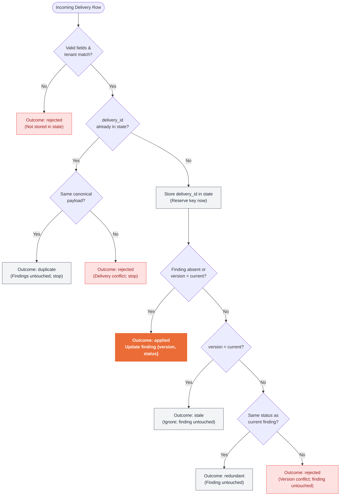

# Idempotent Local Webhook Inbox: Complete Implementation & Action Guide

This document defines exactly what you need to do to solve the assessment, detailing the architecture, the 7-step execution roadmap, edge-case traps, and verification requirements.

---

## 1. Executive Summary & Core Concepts

A webhook sender retries deliveries after timeouts, producing **duplicates, out-of-order events, and conflicting deliveries**. You must implement a CLI that processes deliveries safely, ensuring:
1. The same delivery never changes state twice.
2. An older finding version never overwrites a newer finding version.
3. State safely persists across separate CLI process runs.

### The Two Core Invariants

| Concept | Question Asked | Scope | Action When Triggered |
|---|---|---|---|
| **Idempotency** | *"Have I processed this `delivery_id` before?"* | Delivery level | Identical payload &rarr; mark `duplicate`. Different payload &rarr; mark `rejected` (delivery conflict). Finding is untouched. |
| **Monotonicity** | *"Is this version newer than the finding's current version?"* | Entity / Finding level | Version higher &rarr; `applied` (update finding). Version lower &rarr; `stale`. Equal version & same status &rarr; `redundant`. Equal version & different status &rarr; `rejected`. |

---

## 2. Decision Logic Flowchart

Every incoming delivery row passes through the two-tier decision pipeline:



> **Interactive Diagram Available:** A standalone, styled editorial diagram conforming to the Diagram Design editorial design system is available at [`webhook-inbox-architecture-guide.html`](file:///home/regisx001/04-webhook-inbox/docs/webhook-inbox-architecture-guide.html).

---

## 3. Step-by-Step Action Plan: What You Should Do, in Order

### Step 1: Baseline Confirmation
- Run the existing smoke test suite and baseline CLI:
  ```bash
  python3 -m unittest discover -s tests -p '*_test.py' -v
  python3 app.py --input inputs/primary.json
  ```
- **Expectation:** The test suite passes; `python3 app.py --input inputs/primary.json` prints `STARTER: implement ingest_events` to `stderr` and exits with code **3**.
- Confirm standard CLI parameters:
  - `--input`: path to input JSON fixture (default: `inputs/primary.json`).
  - `--tenant`: tenant filter (default: `north`).
  - `--state`: path to state JSON file (default: `state.json`).

---

### Step 2: Implement Input and State Validation
Implement strict validation before any mutations occur:

1. **Row Validation:**
   - Required fields: `delivery_id`, `tenant`, `finding_id`, `version`, `status`.
   - String fields must be non-empty after trimming (`.strip()`).
   - `version` must be a strictly positive integer (`> 0`).
     - **Watch out:** In Python, `isinstance(True, int)` evaluates to `True`! You must explicitly check `type(version) is int and not isinstance(version, bool)`.
   - `status` must be either `"open"` or `"resolved"`.
   - `tenant` must match the CLI `--tenant` argument (case-sensitive).
   - If invalid or foreign: mark outcome as `rejected` with an appropriate reason. **Crucially: do not reserve or store the `delivery_id` in state!**

2. **State File Validation:**
   - If `--state` file does not exist: initialize an empty state dictionary for the tenant:
     ```json
     {
       "tenant": "<cli_tenant>",
       "deliveries": {},
       "findings": {}
     }
     ```
   - If `--state` file exists:
     - Read and parse JSON.
     - Validate that root is an object containing `tenant`, `deliveries` (mapping), and `findings` (mapping).
     - Verify `state["tenant"] == cli_tenant`.
     - **If malformed, wrong tenant, or schema-invalid:** Print diagnostic to `stderr` and **exit immediately with code 2 without modifying the state file bytes!**

---

### Step 3: Implement the In-Memory Event Processing Engine
Process delivery rows strictly in sequence (since row $N+1$ may depend on state changes from row $N$):

1. **Delivery Identity Check:**
   - Check if `delivery_id` is present in `state["deliveries"]`.
   - If present:
     - Compare canonical incoming payload `{tenant, finding_id, version, status}` against the stored payload.
     - Match &rarr; outcome: `duplicate`, reason: `"duplicate delivery"`.
     - Differ &rarr; outcome: `rejected`, reason: `"delivery conflict"`.
     - Stop evaluation for this row; findings remain untouched.

2. **Reserve Idempotency Key:**
   - If `delivery_id` is new: store canonical payload in `state["deliveries"][delivery_id]` **immediately**.
   - Even if the version is later classified as `stale`, `redundant`, or `rejected` (version conflict), the delivery key remains reserved!

3. **Monotonic Version & Status Check:**
   - Retrieve current finding state from `state["findings"].get(finding_id)`.
   - **Case A: Finding absent or `row.version > current.version`:**
     - Update finding: `state["findings"][finding_id] = {"version": row.version, "status": row.status}`.
     - Outcome: `applied`.
   - **Case B: `row.version < current.version`:**
     - Outcome: `stale` (ignore old event; finding is untouched).
   - **Case C: `row.version == current.version`:**
     - If `row.status == current.status` &rarr; outcome: `redundant` (finding untouched).
     - If `row.status != current.status` &rarr; outcome: `rejected` (version conflict; finding untouched).

---

### Step 4: Implement Atomic State Serialization
State must only be written to disk if processing succeeds:
1. Ensure the directory of the state file exists.
2. Create a temporary file in the **same directory** as the target state file (e.g. using `tempfile.NamedTemporaryFile(dir=target_dir, delete=False)` or `<state_path>.tmp`).
   - *Why same directory?* Moving files across filesystem mounts or partitions cannot be atomic. A same-directory rename (`os.replace`) is guaranteed to be atomic by POSIX.
3. Write formatted JSON to the temporary file, flush buffers (`f.flush()`), and sync if necessary (`os.fsync(f.fileno())`).
4. Atomically swap: `os.replace(temp_path, final_state_path)`.
5. If writing or replacing fails: clean up the temporary file, print diagnostic to `stderr`, and exit with code **2**, leaving previous state intact.

---

### Step 5: Verify Against the Primary & Secondary Fixtures
Run the standard verification commands using a scratch state file (e.g., `scratch-state.json`):

#### Verification Run 1 (Fresh primary):
```bash
python3 app.py --input inputs/primary.json --tenant north --state scratch-state.json
```
**Expected Counts:**
- `applied`: 3
- `duplicate`: 1
- `stale`: 1
- `redundant`: 0
- `rejected`: 4
- **Exit Code:** 0

#### Verification Run 2 (Replay primary against saved state):
```bash
python3 app.py --input inputs/primary.json --tenant north --state scratch-state.json
```
**Expected Counts:**
- `applied`: 0
- `duplicate`: 6 (rows 1, 2, 4, 5, 8, 9)
- `stale`: 0
- `redundant`: 0
- `rejected`: 3 (rows 3, 6, 7)
- **Exit Code:** 0

#### Verification Run 3 (Secondary fixture against persisted state):
```bash
python3 app.py --input inputs/secondary.json --tenant north --state scratch-state.json
```
**Expected Counts:**
- `applied`: 2
- `duplicate`: 0
- `stale`: 0
- `redundant`: 1
- `rejected`: 0
- **Exit Code:** 0

---

### Step 6: Replace Starter Test with Comprehensive Test Suite
Replace the placeholder test in `tests/app_test.py` with feature tests that verify contract behavior:
1. **End-to-End Fixture Runs:** Verify exact counts and stdout payload structure for Run 1, Run 2, and Run 3.
2. **Boundary Checks:**
   - `version: true` (boolean) must be rejected and not reserve an ID.
   - Whitespace trimming: `" d1 "` and `"d1"` must collide as duplicate.
   - Finding version 0 or negative integers must be rejected.
3. **Corrupted State File Byte Invariance:**
   - Create a file with invalid JSON (e.g., `"{bad json"`).
   - Record its raw byte contents and modification time.
   - Run CLI pointing to that state file.
   - Assert exit code is **2**.
   - Assert the file's exact bytes are completely unmodified!
4. **Document a Fixed Flaw:** Note at least one edge case that initially failed during development and explain how your fix resolved it (e.g., ensuring Row 9 persists its delivery ID despite the version conflict rejection).

---

### Step 7: Finalize Assessment Deliverables
Prepare the 4 deliverables requested in the candidate README:
1. **Run Guide:** Clear markdown document with reproduction commands and output assertions.
2. **Decision / Work Log:** Document design choices, priorities, trade-offs, and limits.
3. **AI-Use Note:** Honest description of how AI was used (accepted suggestions, corrected hallucinations, or verification steps).
4. **Walkthrough Narrative:** A 3–5 minute readable text walkthrough explaining the core flow and edge case handling.

---

## 4. Row-by-Row Trace of `inputs/primary.json`

| Row | Event Data | Pre-State | Evaluation Step | Outcome | Delivery ID Stored? | Finding State Mutation |
|---|---|---|---|---|---|---|
| **1** | `d1`, f1, v2, `open` | Empty state | f1 absent &rarr; initialize | `applied` | **Yes (`d1`)** | `f1: {v2, open}` |
| **2** | `d1`, f1, v2, `open` | `d1` in state (open) | Seen `d1` + canonical payload matches | `duplicate` | Already stored | None |
| **3** | `d1`, f1, v2, `resolved` | `d1` in state (open) | Seen `d1` + status differs (delivery conflict) | `rejected` | Already stored | None |
| **4** | `d2`, f1, v1, `resolved` | `d2` new; f1 at v2 | Store `d2`; version 1 < 2 (out of order) | `stale` | **Yes (`d2`)** | None |
| **5** | `d3`, f1, v3, `resolved` | `d3` new; f1 at v2 | Store `d3`; version 3 > 2 (newer) | `applied` | **Yes (`d3`)** | `f1: {v3, resolved}` |
| **6** | `d4`, tenant `south` | Target: `north` | Foreign tenant &rarr; validation rejection | `rejected` | **No** | None |
| **7** | `d5`, f2, v0, `open` | Empty f2 | Version 0 &le; 0 &rarr; validation rejection | `rejected` | **No** | None |
| **8** | `d6`, f2, v1, `open` | `d6` new; f2 absent | Store `d6`; f2 absent &rarr; initialize | `applied` | **Yes (`d6`)** | `f2: {v1, open}` |
| **9** | `d7`, f1, v3, `open` | `d7` new; f1 at v3 resolved | Store `d7`; v3 == v3, but open != resolved | `rejected` | **Yes (`d7`)** | None |

---

## 5. Summary of Traps & Pitfalls

1. **Trap: Stored vs Discarded Rejections:**
   - *Wrong:* Marking an event `rejected` and discarding it from state.
   - *Right:* Version conflicts (Row 9) are valid deliveries that conflict with current entity state. Their `delivery_id` **must be stored**. Malformed rows (Row 6, Row 7) are invalid and **must not be stored**.

2. **Trap: Python `bool` is a subclass of `int`:**
   - In Python: `issubclass(bool, int) is True`.
   - `isinstance(True, int)` returns `True`.
   - Always validate with: `type(val) is int and not isinstance(val, bool) and val > 0`.

3. **Trap: Whitespace in IDs and Keys:**
   - Ensure all string inputs (`delivery_id`, `tenant`, `finding_id`, `status`) are stripped of leading/trailing whitespace before comparison, validation, or persistence.

4. **Trap: Non-Atomic State Writes:**
   - Writing directly with `open(state_path, "w")` can leave a truncated or corrupted file if the process terminates mid-write.
   - Always write to a sibling temporary file in the same directory, flush, and atomically rename with `os.replace`.

5. **Trap: Corrupted State Handling:**
   - When given an invalid state file (syntax error or missing fields), do not attempt recovery or overwriting. Exit immediately with code **2**.
